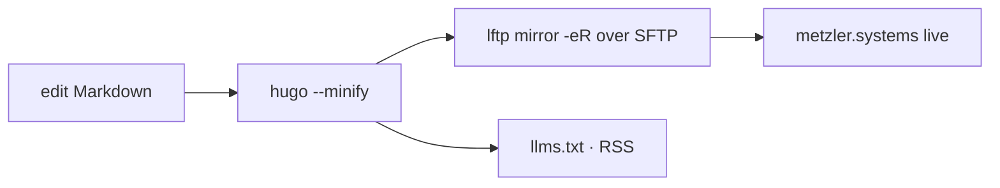

This site is a static Hugo build and a publish script. That's the whole architecture. Here is why that's enough.

## The short answer

- Hugo turns Markdown into static HTML. Builds in under a second, ships minimal JavaScript.
- `publish.sh` runs `hugo --minify` and then `lftp mirror -eR` over SFTP to the webhosting box. No SSH, no CI pipeline — one command, incremental sync.
- WordPress is gone. No database, no plugin roulette, no PHP-FPM pool doing CMS work on every page view.

The whole pipeline, as a diagram:

## Why static beats dynamic for a site like this

Every page view of a CMS is a computation. Every plugin is a liability with a changelog. A static site is just files: the webserver serves them with Let's Encrypt and DDoS protection already included in the hosting package, Core Web Vitals are excellent by construction, and an attack surface that consists of read-only files is a small attack surface.

The rule I applied: everything that can be static must be static.

## Being found: SEO and the AI-crawler side

Static HTML is already the most scraper-friendly format that exists. I went one further:

- A generated [`/llms.txt`](/llms.txt), following the [llms.txt v2 proposal](https://llmstxt.org/), gives AI agents a front door to the whole site.
- RSS feeds per section (`/blog/index.xml`), a `sitemap.xml`, and WebSite JSON-LD on the homepage round out the machine-readable surface.
- `robots.txt` allows the AI *search* and *user* agents — so AI answers can cite these pages — while the model-*training* crawlers (GPTBot, CCBot, Google-Extended, …) are blocked. Visible in the answers, absent from the training data.

## What it costs

A small webhosting package. That's it.
