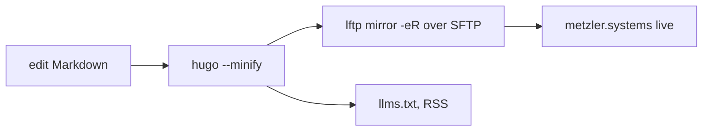

Update, November 2026: publishing no longer goes over SFTP. The site now builds into a container image, lands in GHCR, and Flux deploys it to an Infomaniak Kubernetes cluster. Current stack on the [privacy page](/privacy/) and the [links page](/links/).

This site is a static Hugo build and a publish script. That's the whole architecture, and it is enough.

## The short answer

- Hugo turns Markdown into static HTML. Builds in under a second, ships minimal JavaScript.
- `publish.sh` runs `hugo --minify` and then `lftp mirror -eR` over SFTP to the webhosting box. No SSH, no CI, one command, incremental sync.
- WordPress is gone: no database, no plugin roulette, no PHP-FPM pool doing CMS work on every page view.

The pipeline:

## Why static beats dynamic for a site like this

Every page view of a CMS is a computation. Every plugin is a liability with a changelog. A static site is just files: the webserver serves them with Let's Encrypt and DDoS protection already included in the hosting package, Core Web Vitals are good by construction, and read-only files are a small attack surface.

The rule I applied: everything that can be static must be static.

## Being found: SEO and the AI-crawler side

Static HTML is about as scraper-friendly as it gets. I went one step further:

- A generated [`/llms.txt`](/llms.txt), following the [llms.txt v2 proposal](https://llmstxt.org/), gives AI agents a front door to the whole site.
- RSS feeds per section (`/blog/index.xml`), a `sitemap.xml`, and WebSite JSON-LD on the homepage make up the machine-readable side.
- `robots.txt` allows the AI *search* and *user* agents, so AI answers can cite these pages, while the model-*training* crawlers (GPTBot, CCBot, Google-Extended, ...) are blocked. Visible in the answers, absent from the training data.

## What it costs

A small webhosting package. That's it.
