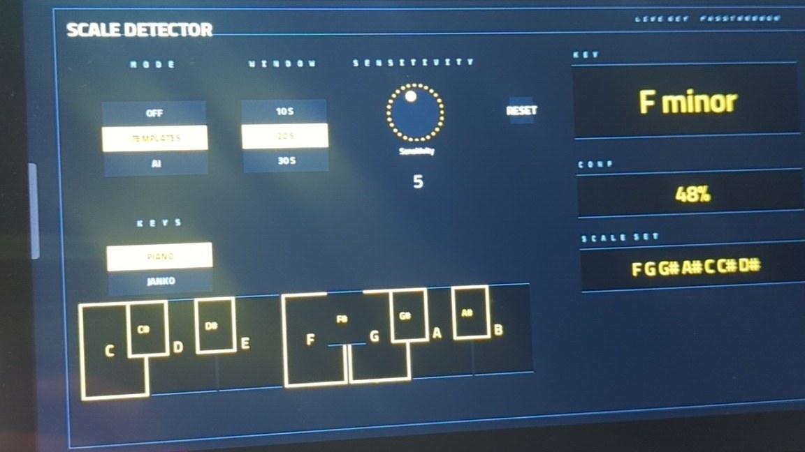
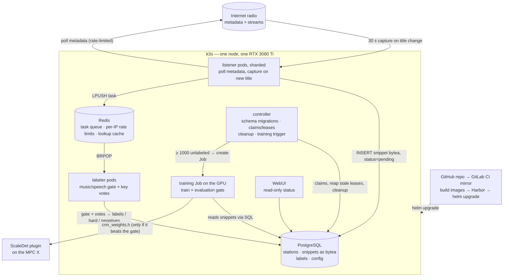

ScaleDet is a VST3/AU plugin I built for the Akai MPC X: it shows the musical key and scale of whatever audio is playing, in real time, on the device screen. The detector is a small CNN over a chroma front end, and a CNN needs training data. Lots of it, and *labeled* data at that.

The training data source I chose is public internet radio: thousands of stations stream 24/7 with now-playing metadata. When the title changes, a 30-second snippet of the stream is exactly one training sample, and the song title is a weak label I can look up. That's the harvester. What started as a single Python process writing CSVs is now being split into microservices on my homelab, which doubles as structured CKA exam prep, because every Kubernetes topic I need is exactly what the project needs next. It's a solo project I've been building since early 2026: hardware, cluster, and pipeline are all mine.

## The end-to-end idea

Per song, the pipeline is:

1. A listener pod polls a station's now-playing metadata at a polite pace, on a new title it records 30 s with ffmpeg.
2. The mp3 goes into PostgreSQL as a `bytea` blob (PG is the *only* canonical store, the CSV era is over) and a task id is pushed to Redis.
3. A labeler pod pops the task, materializes the blob to tmpfs, runs a music/speech gate, collects key "votes" from lookup sources, and writes a consensus label row.
4. The controller hands out station shards with leases, reaps dead pods' claims in under 2.5 minutes, cleans up orphans, and fires a training Job on the GPU once enough unlabeled data has piled up.
5. The Job trains the CNN and only promotes weights that pass a fixed evaluation gate (MIREX score on a held-out set, plus a regression check), then the new `cnn_weights.h` gets compiled into the plugin. Deploying to the MPC stays a manual step.

## Why this shape

- Single-node k3s on the GPU box. One node dissolves all RWO/RWX storage questions, local-path plus one OpenEBS LVM volume for PostgreSQL is enough. The escape hatches for multi-node later (nodeSelectors, separate releases) stay open.
- PostgreSQL for blobs, Redis for speed. Snippet audio lives in PG as `bytea` (with autovacuum tuned for the churn), Redis is just the at-most-once queue, the cluster-wide per-IP rate limiter, and the lookup cache. Losing one queue task is accepted, the hourly cleanup reaps the orphan.
- Politeness is a hard requirement: per-IP request caps, per-host station caps, paced polling, captures only on title changes. A bug must never DDoS a small radio station.
- No umbrella chart, no operators: one app Helm chart in its own namespace, infra as separate releases, plain Deployments/StatefulSets, best practice, not gold-plating.

## What this demonstrates

- Kubernetes in real conditions: not a toy cluster, Deployments/StatefulSets, PVCs and StorageClasses, Secrets, claims/leases, kill drills, a minimal-RBAC CI deployer, Helm releases.
- Data-pipeline design: PostgreSQL as the single canonical store (audio blobs included), Redis as an at-most-once queue, idempotent schema migrations, weak-label consensus voting.
- MLOps hygiene: a fixed evaluation gate before any model ships, a regression check on a hard set, and training data that never leaves the cluster.

## The CKA angle

The project is deliberately organized as 17 dependency-ordered tickets, and each one maps to an official CKA domain, storage (done: PVCs, StorageClasses), workloads (Deployments, sharding), scheduling (resource limits, the GPU node), Jobs/CronJobs, Secrets, Services/Ingress/Gateway API, NetworkPolicy, observability, RBAC for the CI deployer. Theory first, then the ticket on the real cluster, then exam-style drills in Killercoda for the gaps a single-node k3s can't cover (kubeadm, etcd backup/restore, HA). Troubleshooting gets daily practice with a purpose: kill drills where a murdered listener pod's shard must be reassigned in under 2.5 minutes.

## Roadmap & gates

The 17 tickets group into seven phases. Each phase ends at a gate, a measurable acceptance check, usually one SQL query or one kill drill, not a feeling. Status as of 2026-11-03:

```mermaid
flowchart LR
    P1["1 · k3s + GPU + PG/Redis ✅"] --> P2["2 · schema + 10 000 import ✅"]
    P2 --> G1{{"Gate A<br/>100 stations end-to-end<br/>one SQL join"}}
    G1 --> P3["3 · tracer bullet 🟡<br/>claims/leases · politeness<br/>load test · ramp to 5000"]
    P3 --> G2{{"Gate B<br/>kill drill: shard back<br/>< 2.5 min, 24 h stable"}}
    G2 --> P4["4 · monitoring ⬜"]
    P4 --> G3{{"Gate C<br/>4 Grafana dashboards live"}}
    G3 --> P5["5 · training on GPU"]
    P5 --> G4{{"Gate D<br/>eval gate accepts/rejects<br/>correctly on the 3080 Ti"}}
    G4 --> P6["6 · Harbor + GitLab CI loop"]
    P6 --> G5{{"Gate E<br/>GitHub push → images<br/>→ helm upgrade"}}
    G5 --> P7["7 · WebUI + internal TLS"]
    P7 --> G6{{"Gate F<br/>status page live, config change<br/>effective < 30 s, wildcard TLS"}}
    style P1 fill:#c8e6c9
    style P2 fill:#c8e6c9
    style P3 fill:#fff9c4
```

| # | Ticket | Gate / acceptance | Status |
|---|--------|-------------------|--------|
| 01 | k3s foundation + GPU stack | node Ready, GPU pod runs nvidia-smi, PG + Redis green | [x] done |
| 02 | PG schema + station import | migrations idempotent, 10 000/10 000 rows, spot-check 5/5 | [x] done |
| 03 | tracer bullet, 100 stations | title change -> snippet bytea -> consensus label, one SQL join | [~] in progress |
| 04 | claims / leases / sharding | kill drill x3: shard reassigned < 2.5 min, no double-claims | [ ] |
| 05 | cluster-wide politeness | per-IP caps via Redis, pacing, rate-limit hits flat | [ ] |
| 06 | controller housekeeping | hourly orphan cleanup + max-gb as pg_database_size | [ ] |
| 07 | observability release | metrics everywhere, 4 dashboards | [ ] |
| 08 | stationsPerPod load test | measured value from 50/100/200 burst, no gate timeouts | [ ] |
| 09 | ramp 500->1000->5000 | 5 000 stations, 24 h stable each step | [ ] |
| 10 | training adapter `--from-postgres` | data tree built from SQL, no CSVs anywhere | [ ] |
| 11 | training Job + gate on GPU | Job visibly on the GPU, gate decision logged per run | [ ] |
| 12 | Harbor + image split | slim / labeler / trainer images in Harbor | [ ] |
| 13 | GitLab CI loop | push -> mirror -> build -> deploy, minimal-RBAC SA | [ ] |
| 14 | WebUI read-only status | status page live, cluster-internal | [ ] |
| 15 | WebUI runtime config | `harvest_config` change effective < 30 s, no restarts | [ ] |
| 16 | internal TLS | cert-manager DNS-01 wildcard | [ ] |
| 17 | ops hardening | nightly pg_dump backups, secrets hygiene | [ ] |

## Where it stands

Phase 1 is green: k3s up, GPU device plugin working, PostgreSQL (20 Gi PVC) and Redis deployed via Helm, verified from test pods. Phase 2 just landed: the controller subcommand applies the schema idempotently and imported the full 10 000-station registry into PG, row count matches the source exactly. Next up is the tracer bullet (ticket 03): ~100 stations end-to-end, one SQL join showing title change -> snippet -> label.

Honest caveats: a single node is a single point of failure (fine for a homelab), and the ~160 Mbit/s uplink remains the real ceiling, Kubernetes removes the process bottleneck, not the bandwidth one. Recording radio streams is gray-area in some jurisdictions, so the audio stays local in PostgreSQL, is used only to train the model, and is never published or shared, and the stations themselves are polled politely and rate-limited, so a bug can't become a DDoS. The plugin repo stays private, but I'm happy to walk through the code in an interview, the plugin running live on the MPC X is shown above (a short screen recording is coming). Training data lives in PG and never in git.
